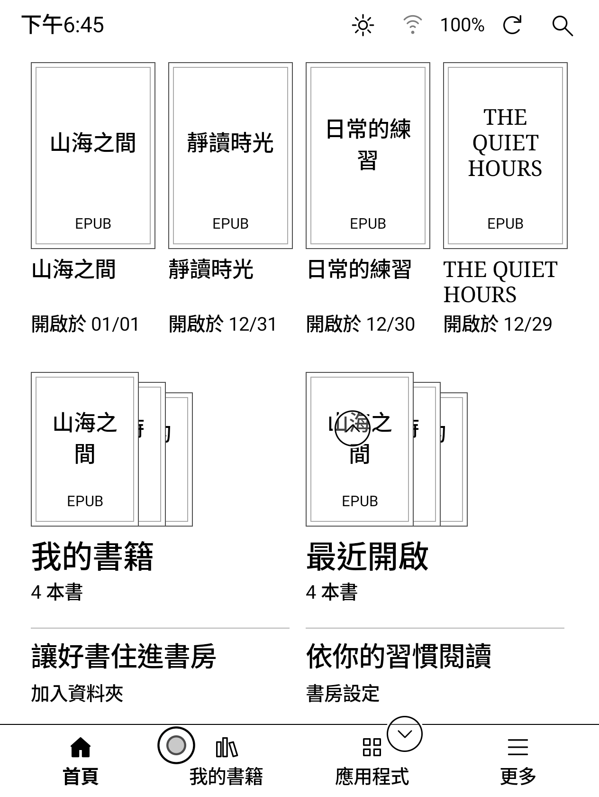

# KoboStyle Launcher for BOOX Leaf2

讓 BOOX Leaf2 變成更簡潔的電子紙書房。這個以 Codex 協助開發的 Kotlin 專案提供 Kobo 風格首頁、封面書庫、最近開啟與書名／作者搜尋，同時保留 BOOX NeoReader 和原廠桌面。

以一般 App 啟動，透過 Android Storage Access Framework（SAF）加入內部儲存或 microSD 的 EPUB／PDF；以 Room 管理索引與自己的開啟紀錄，再透過 ACTION_VIEW 將書籍交給可處理的閱讀器。繁體中文為預設介面，另有英文資源。

這是獨立專案，非 Kobo 或 BOOX 官方產品，沒有 Kobo 商店、雲端同步或 NeoReader 閱讀進度整合。



上圖為 Leaf2 上使用合成書籍的介面驗收畫面。實際書庫畫面與橫向配置見 [UI 更新與驗收](docs/UI_REDESIGN_2026-11-16.md)。原始設計參考圖僅留在開發者本機，不納入儲存庫。

原始碼位於 `app/src/main/`，JVM 測試位於 `app/src/test/`，實機測試位於 `app/src/androidTest/`；建置與驗收腳本位於 `scripts/`。完整紀錄見 [文件導覽](docs/README.md)。

## 目前進度

- 2026-11-25：V4 書靈 P1–P5 已完成主機開發，尚未安裝到 Leaf2。新增免費 Lite 書靈、單書知識包／引用與防劇透問答、費用確認／緊急停止、50 本分頁及可續掃索引。從「更多 → 書靈與費用設定」手動開啟，新付費功能預設關閉。106 項 JVM／Robolectric 與 2 項 Python 測試通過，Lint 0 errors／61 warnings；詳細操作、限制、主機預覽與 P6 接機清單見 [V4 紀錄](docs/v4/IMPLEMENTATION_2026-11-25.md)。以下 Leaf2 數據均屬較早版本。
- 黑白首頁、可調欄數書封網格、搜尋、最近開啟與可選實體鍵翻頁已實作。
- 首頁「書籍分類」提供 11 個類別與作者瀏覽，依 `[類別]-書名-作者名.epub/pdf` 分類；作者清單支援搜尋，另保留全部書籍及未分類。詳見 [分類功能與驗收](docs/CATEGORIES_2026-11-18.md)。
- 第三分頁改為「喵館員」，「應用程式」移至「更多」。墨喵提供六種靜態表情、離線對話選書、主題推薦；可自行啟用 OpenAI 並在裝置輸入 Key。API 僅傳最多 20 本候選書目與當次需求，金鑰以 Android Keystore 加密，失敗可回退離線。詳見 [喵館員開發與驗收](docs/LIBRARIAN_2026-11-20.md)。
- 已在 Leaf2／Android 11 驗證 SAF 匯入、NeoReader 開啟合成 EPUB／PDF、microSD 拔插與授權恢復。
- 大型書庫修復後，microSD Books 的 8,141 本 EPUB／PDF 全數入庫，補入原先漏掉的 4,049 本；含驗收書全庫 8,166 本。162 本使用中繼資料回退，不代表每本都已實際開啟。詳 [掃描修復](docs/SCAN_FIX_2026-11-17.md)。
- 喵館員候選只取已匯入的實際館藏，排除先前驗收資料夾。Leaf2 已確認 8,166 筆索引中排除 25 本驗收書，以其餘 8,141 本選書；推薦頁顯示本次實際核對的可讀候選數。
- 2026-11-20 的 V3 主機驗證為 84 項 JVM 測試通過、Lint 0 errors／45 warnings。該版已安裝到 Leaf2；更換有效 Key 後，真實 OpenAI 推薦回傳 HTTP 200，重複同組推薦命中快取且不增加呼叫次數。先前實際館藏來源與檔案存取測試 1/1 通過，Keystore、喵館員／合成書開書與分類／書庫回歸共 4 項實機測試亦有紀錄。完整結果見 [實機驗收](docs/LIBRARIAN_DEVICE_2026-11-20.md)。
- 繁體注音以另外安裝並配置同文輸入法驗證；鍵盤與字典不包含在本 App。詳 [注音輸入紀錄](docs/INPUT_METHOD_2026-11-17.md)。

保留 BOOX NeoReader 與原廠桌面。沒有 root、ROM 修改、其他 App 私有資料庫存取或全檔案權限。喵館員新增 INTERNET 權限，但 AI 預設關閉、只在使用者啟用並要求推薦時連線。最新版本提供預設停用、需手動啟用的 HOME 入口及「更多 → 桌面與復原」；安裝／一般啟動不會變更預設桌面。使用者完成手動復原示範並核准後，已透過系統 UI 將 Leaf2 設為 KoboStyle 預設桌面；Home／Back、原廠復原、故障選擇器、重開機保留預設與 PDF 開書已驗證。BOOX 開機仍先顯示原廠介面，按一次 Home 才進入 KoboStyle；刻意崩潰後系統會重新要求選桌面。詳 [HOME 設定紀錄](docs/HOME_SETUP_2026-11-16.md)。長期待機尚未驗證，詳見 [測試紀錄](docs/TEST_PLAN.md)。

## 建置（Windows PowerShell）

先安裝 Git、JDK 17、Android SDK platform 36／build-tools 35.0.0／platform-tools，並自行接受 Android SDK 授權。設定 `JAVA_HOME` 指向 JDK、`ANDROID_HOME` 指向 SDK，讓 `adb` 可由 PATH 執行，再執行：

```powershell
git clone https://github.com/victorsue0891/KoboStyleLauncher.git
cd KoboStyleLauncher
.\gradlew.bat assembleDebug testDebugUnitTest lintDebug --console plain
powershell -NoProfile -ExecutionPolicy Bypass -File .\scripts\test_diagnose_device.ps1
```

首次需連網下載建置相依套件；書庫與離線館員可離線運作，選用 OpenAI 推薦需網路及自行提供 API Key。Gradle wrapper JAR 與啟動腳本已納入專案，Gradle 發行包以 SHA-256 驗證。`.tools` 不隨儲存庫提供；只有已自行建立該目錄結構的開發環境才使用 `. .\scripts\use_local_tools.ps1`，它只調整當前 PowerShell 的環境變數。

固定版本：AGP 8.13.2、Gradle 8.13、Kotlin 2.2.21、KSP 2.2.21-2.0.4、Room 2.8.4、minSdk 30、compileSdk/targetSdk 36。採 API 36 的穩定相容工具組，沒有為繞過權限而降低 target。AGP/JDK/Gradle 相容性依據：[Android 官方版本說明](https://developer.android.com/build/releases/agp-8-13-0-release-notes)。

在 Android 11 上，套件查詢受 `<queries>` 限制，SAF 選取根目錄亦有限制。Android 15/16 上處理 system bars insets，沒有強制方向或 HOME role；其他 Android 版本尚無實機測試。

首次核心驗證：debug APK 建置成功、18/18 JVM/Robolectric 測試與 6/6 診斷 mock 測試通過；當時 Lint 0 errors、19 個版本／寫法建議。APK 已驗證 debug 簽章，後續已安裝修正版至 Leaf2；EPUB/PDF 真實開書、翻頁、正常返回、重啟保存、異常文件及 100／1000 本獨立索引測試已通過。解凍後啟動回歸通過，歷史紀錄詳 [實機驗收紀錄](docs/ACCEPTANCE_2026-11-15.md)，最新結果見下方補充驗收。

APK 路徑：`app/build/outputs/apk/debug/app-debug.apk`。
Application ID：`org.kobostyle.launcher`。debug 簽章只供開發測試。

2026-11-15 補充驗收：主機測試增加至 21 項；單一文件真實授權撤銷／恢復、microSD 實體拔插／恢復、字級 1.0／1.3、1000 筆書架取樣、60 秒 App 無重繪及一次正常重開機後開書已驗證。實體 Leaf2 按鍵觀察到 25／24，已加入可選翻頁與反向設定；標準 Page Up／Page Down 亦支援。詳 [補充驗收與重現命令](docs/EXTENDED_ACCEPTANCE_2026-11-15.md)。

## 裝置測試

使用者連線且授權後，P0 唯讀命令：

```powershell
powershell -NoProfile -ExecutionPolicy Bypass -File .\scripts\diagnose_device.ps1
```

使用者已授權並完成實機安裝；以下命令可重現安裝：

```powershell
powershell -NoProfile -ExecutionPolicy Bypass -File .\scripts\deploy_debug.ps1
```

從 BOOX Apps 手動啟動，不變更 HOME。開書前閱讀 [P3 逐步程序](docs/P3_PROCEDURE.md)；P5 必須有 [手動復原示範](docs/RECOVERY.md) 與明確核准。

## 使用方式與限制

- 「我的書籍」→ 加入資料夾或加入書籍。只保留持續「讀取」授權。來源不支援持續授權時提示重新選取。
- 點書封／書名開書；長按封面或書籍旁「⋯」開啟選單，可選「其他閱讀器」。頂端放大鏡搜尋本機索引中的書名／作者，支援「顯示全部書籍」。首頁僅顯示實際開啟日期，沒有虛構閱讀百分比。
- 頂端時鐘、電量與 Wi-Fi 於回到前景時更新，避免定時重繪。太陽圖示開啟系統設定，並非未經驗證的 BOOX 亮度控制。僅在本 App 隱藏系統狀態列，可由頂端滑出；不更改全域系統設定。
- 使用者觸發單一 IO coroutine 掃描，可以取消；旋轉保留 ViewModel。App process 結束時掃描停止，重開後可手動重掃；沒有常駐或週期性工作。
- 原始書籍不修改。Room 以 provider authority + document ID 去重，儲存來源 URI、大小、修改時間、作者、封面、掃描狀態及自己的開啟事件。重新掃描保留開啟紀錄。
- EPUB 支援 container → OPF、EPUB 2 cover meta、EPUB 3 cover-image。單一 archive 上限 128 MiB、4096 entries、中央目錄 4 MiB（開啟 ZIP 前檢查，拒絕 ZIP64／分卷）、宣告展開總量 256 MiB、XML 1 MiB、封面 4 MiB、200 倍壓縮比例、XML 深度 64。SVG 封面或不支援的格式使用預設圖示。這些上限可能拒絕部分合法大書。
- PDF 使用 PdfRenderer，僅渲染第一頁、檔案大小上限 256 MiB，縮圖最多 240×360。作者不推測，標題採 SAF 檔名；損壞、加密或不支援 seek 的 provider 回退預設封面。原生 PDF renderer 的所有惡意輸入風險不能只靠單元測試排除。
- 封面灰階、降採樣，磁碟 cache 32 MiB。cache 被系統清除或淘汰時顯示預設圖示；正常且未變更的中繼資料會重用，重掃不保證重建被淘汰的縮圖。
- 每次掃描最多 50000 個文件／資料夾、32 層，重複 document ID 不重訪。超限會顯示縮小來源的提示並保留既有書籍狀態，不當作授權失效；一般 provider 查詢錯誤提示重新掃描。provider 本身不回應時取消可能延遲。來源授權有效、檔案大小／修改時間相同的正常書籍會重用已儲存的中繼資料，減少重掃時間。
- 授權失效、來源遺失或 SD 拔除會顯示不可用／重新授權。沒有自動修復外部權限、複製書籍或清除原始檔案。
- 「上次開啟」是送出 intent 或 chooser 選定處理器的時間，沒有取得閱讀進度或成功載入證明。取消 chooser 不記錄；App 在 chooser 期間被系統銷毀可能遺失事件。
- 閱讀器 capability 查詢不等於實際相容性。沒有硬編碼 NeoReader 元件；預設處理器失敗時可按「其他閱讀器」。沒有 handler 時顯示錯誤。
- 「更多 → 應用程式」只顯示 PackageManager 可見的啟動活動；不是所有安裝套件清單。Wi-Fi／電量只在返回前景時取樣，不讀 SSID、不持續輪詢。
- 首頁／書庫支援標準 Page Up／Page Down。Leaf2 本次實體按鍵確認送出音量減／加事件；可在設定開啟「實體鍵翻頁」並切換一般／反向，立即移動約 90% 可視高度。新安裝預設關閉，不更改 BOOX 全域按鍵或 NeoReader 設定。
- E Ink controller 為 no-op；不宣稱支援 BOOX SDK 或全螢幕刷新。實體按鍵以本次觀察到的標準 Android 音量事件實作可選對應。XML theme + 原生 Views/RecyclerView、關閉 item animator／overscroll／ripple；長期殘影與效能統計仍待量測。

設計依據：[SAF 官方說明](https://developer.android.com/training/data-storage/shared/documents-files)、[Room 官方說明](https://developer.android.com/jetpack/androidx/releases/room)。
