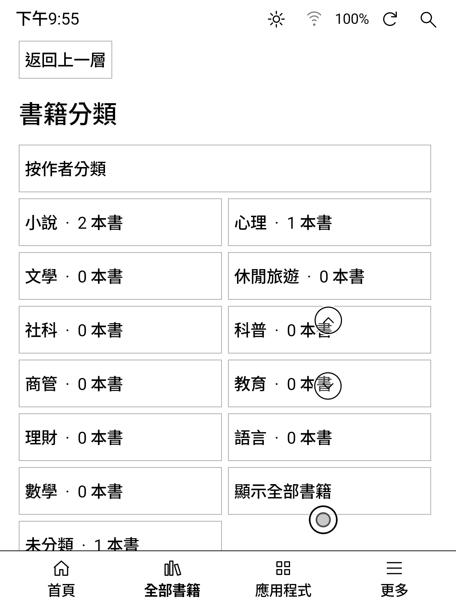

# 書籍分類與作者瀏覽（2026-11-18）

首頁原「我的書籍」書堆改為「書籍分類」。進入後提供「按作者分類」，以及小說、心理、文學、休閒旅遊、社科、科普、商管、教育、理財、語言、數學。分類按鈕顯示本數；底部「全部書籍」仍直接進入完整書庫。

分類頁採黑白雙欄按鈕，窄螢幕或大字型時降為單欄；內容可捲動，實體翻頁鍵沿用使用者原有的可選設定。作者以繁體中文排序，顯示各自本數，可用右上角搜尋縮小作者清單。「返回上一層」和系統 Back 依序返回作者／分類頁；旋轉保留分類、作者與查詢。



此圖僅含合成書庫的本數；畫面右側圓形浮動控制為裝置原有介面。

## 檔名規則與相容性

- 正式規則：`[類別]-書名-作者名.副檔名`，支援 EPUB／PDF，副檔名大小寫不拘。例如 `[小說]-合成故事-作者甲.epub`。
- 去除欄位前後空白並做 Unicode NFC 正規化；也接受 `【類別】` 與右括號後省略第一個連字號的形式。
- 書名可包含連字號；最後一個 `-` 視為作者起點。因此作者姓名本身含 `-` 時仍有歧義，本版不猜測。
- 有合法分類標籤、但缺少作者的檔名仍可分類。作者優先使用檔名，無法解析時使用既有中繼資料作者；皆無資料時列入「作者不詳」。未知或拼錯的類別列入「未分類」，不自動改寫檔名、不猜測同義類別。
- 保留 EPUB 原有標題與作者中繼資料；分類作者只用於瀏覽／顯示，不覆寫原書內容。書籍搜尋也涵蓋解析出的檔名書名及作者；分類內搜尋維持分類範圍。
- Room 由 v1 升級 v2，僅新增 `displayName TEXT NOT NULL DEFAULT ''`，無 destructive fallback。正常掃描及快取重用路徑都保存 SAF display name。
- 舊版已匯入的 Android external-storage provider 文件，可由已知路徑形式的 document ID 取得檔名，現有 Leaf2 書庫不必重新全掃。其他 provider 的不透明 ID 不視為檔名；舊記錄須正常重掃取得 display name 後才能使用檔名分類，仍可從全部書籍及既有作者找到。

## 命令與結果

```powershell
powershell -NoProfile -ExecutionPolicy Bypass -File scripts/diagnose_device.ps1
. .\scripts\use_local_tools.ps1
.\gradlew.bat assembleDebug assembleDebugAndroidTest testDebugUnitTest lintDebug --console plain
powershell -NoProfile -ExecutionPolicy Bypass -File scripts/deploy_debug.ps1
adb shell am start -W -n org.kobostyle.launcher/.ui.MainActivity
adb install -r app/build/outputs/apk/androidTest/debug/app-debug-androidTest.apk
adb shell am instrument -w -r -e class org.kobostyle.launcher.CategoryUiAcceptanceTest,org.kobostyle.launcher.ReaderUiAcceptanceTest org.kobostyle.launcher.test/androidx.test.runner.AndroidJUnitRunner
adb shell cmd package resolve-activity --brief -a android.intent.action.MAIN -c android.intent.category.HOME
adb shell settings get secure default_input_method
```

一般開發環境請依 README 設定 JDK／SDK，不要求 `.tools`。以上安裝與 instrumentation 僅在使用者授權測試的裝置執行。

- 建置成功；43 項 JVM 測試，0 failures／errors／skipped。新增 7 項分類解析／分組／搜尋測試及 1 項真實 v1 SQLite→Room v2 升級測試，並在掃描快取與重解析測試中檢查 display name 保存。
- Lint：0 errors／32 warnings，未增加 baseline。既有警告包含相依版本、UseKtx、UnusedResources、PluralsCandidate、StaticFieldLeak。
- 覆蓋安裝 Success，主 Activity 正常啟動。APK SHA256：`41923AAB5FEF518418ADF06A8B13D9C3F3737A4CA45C494F68C472374AECCACE`。
- 實機 runner：`OK (2 tests)`。分類測試使用獨立記憶體資料庫與 4 本合成資料，驗證全部分類按鈕、分類篩選、空分類、作者搜尋／分組、未分類、返回、recreation、直橫向與字型 1.3，以及全部書籍入口。既有首頁／書庫／書名作者搜尋／閱讀器選單回歸也通過。
- 測試未開啟真實書籍或重新執行 NeoReader content URI 測試；也不以截圖推論實體電子紙殘影品質。
- 實際 App 資料庫升級前後副本通過 SQLite quick_check，8,166 本全部既有欄位逐列相同，四個 sources 相同；包含 9 筆非零開啟時間，沒有移除書籍或重設歷史。
- 預設 HOME 仍是 `org.kobostyle.launcher/.ui.HomeEntry`；輸入法仍是 `com.osfans.trime/.ime.core.TrimeInputMethodService`。沒有更動原廠套件、預設桌面或鍵盤。

原始資料庫、實際書籍畫面與 UI hierarchy 僅保留在忽略的 `.tools/category-check/`，不公開私人書名或作者名。

## 真實書庫畫面核對

透過實際首頁的「書籍分類」入口逐項比對 11 個分類按鈕本數，與索引檔名統計一致：小說 5,302、心理 584、文學 95、休閒旅遊 0、社科 134、科普 401、商管 845、教育 139、理財 247、語言 30、數學 60，合計 7,837 本；另有未分類 329 本，總數仍為 8,166 本。

已實際點入小說與一位作者的書單，確認標題本數符合選定條件，再循返回入口回到分類頁。這些操作沒有開啟任何私人書籍。分類頁最終留在裝置前景。
