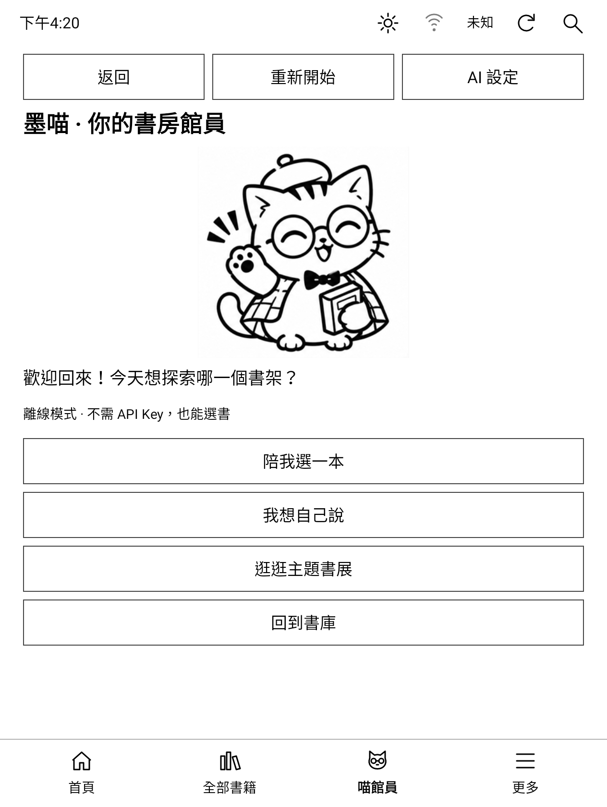
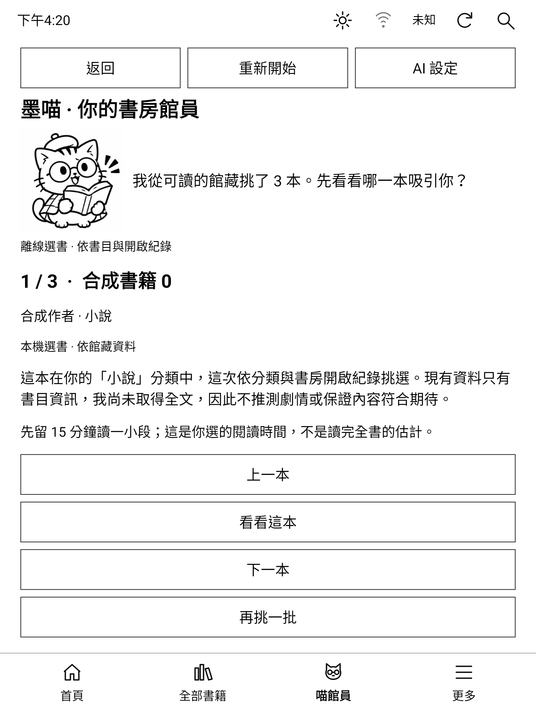

# 喵館員：離線選書與 OpenAI 串接

日期：2026-11-20（Asia/Taipei）。使用者要求把第三個「應用程式」分頁改為「喵館員」，並明確指定本輪一併實作 OpenAI 串接，擴充規格包原定的 P0＋P1 範圍。

同日後續使用者已接機並授權驗收。下方為接機前的開發紀錄；最新實際安裝、Keystore、喵館員與閱讀器結果見 [Leaf2 實機驗收](LIBRARIAN_DEVICE_2026-11-20.md)。

## 現況與本輪決策

在既有 Kotlin 專案上增量開發，未替換書庫。以 `feature/cat-librarian-v3` 分支工作；先以 `2384606` 保存先前分類功能。Room 維持 v2，沒有 migration、清空書庫、重掃或修改既有開啟紀錄。本輪沒有執行 ADB、安裝 App、變更 HOME 或推送 GitHub。

主機已有專案本機 JDK 17、Android SDK 36、build-tools 35.0.0、Gradle wrapper 8.13 與 adb 工具，編譯所需相依套件齊全。使用者表示 Leaf2 尚未連接，因此沒有把歷史裝置報告當成本次連線證據。P0 主機盤點完成；裝置診斷與新功能實機 gate 待接機。

| 已完成 | 未完成 | 阻礙／後續條件 |
|---|---|---|
| 四分頁改為首頁、全部書籍、喵館員、更多；應用程式移到更多 | 新導覽在 Leaf2 上操作驗收 | 裝置尚未連線 |
| 墨喵六種靜態表情、離線流程、自由文字、主題選書與三張推薦卡 | 電子紙殘影、實體鍵與同文注音回歸 | 需實機與人工觀察 |
| Responses API 直連、金鑰加密、嚴格回應驗證、取消／重試／限額／快取 | 真實 API 成功回應、實際帳務與網路相容性 | 需裝置網路及使用者在裝置自行輸入可用 Project API Key |
| 保留既有 SAF、分類、Room v2 與 ACTION_VIEW 橋接；點擊開書前重新檢查文件 | 從喵館員開啟三本合成書、返回與 chooser 回歸 | 需接機後按下列程序測試 |
| 真實 AES-GCM 主機測試、獨立 Android Keystore instrumentation 測試程式已建置 | Android Keystore 測試執行 | 主機注入的是記憶體 AES key，不能替代 AndroidKeyStore 實測 |

## 使用方式

1. 點「喵館員 → 陪我選一本」，依序選心情、15／30／60 分鐘、是否優先尚未從書房開啟。
2. 點「請墨喵幫我挑選」或「這次只用離線選書」。每頁一本，可看上一本／下一本或再挑一批。也能從歡迎頁輸入最多 200 個 Unicode 字元、選擇主題書展。
3. 「看看這本 → 就讀這本 → 開始閱讀」才會開書；另有「使用其他閱讀器」。推薦及模型輸出本身不會啟動閱讀器。
4. 啟用 AI：喵館員右上「AI 設定」，或「更多 → 喵館員 AI 設定」。勾選啟用後才顯示 Key 輸入欄。請在裝置輸入自己的 OpenAI Project API Key，閱讀傳送資料／計費說明後儲存；不要把 Key 貼到聊天、Git 或命令列。
5. 儲存不發請求。下一次明確按「請墨喵用 AI 推薦」才送出。AI 已啟用時，仍可選這次只用離線；之後「再挑一批」保留此選擇。
6. 設定可停用 AI、清空會話與快取、刪除本機 Key，以及透過 SAF 匯出不含書目與 Key 的診斷 JSON。刪除本機 Key 不等於在 OpenAI 撤銷憑證；遠端撤銷須由使用者在帳號管理頁操作。

尚未從本 App 開啟不等於真正未讀；時間是使用者預留的閱讀時間，不是讀完全書估計。離線選書依檔名分類、書名、作者與本 App 開啟紀錄評分，能辨識文字中提到的分類／作者，但不是離線語言模型。

## OpenAI 契約與資料邊界

- 固定 HTTPS `https://api.openai.com/v1/responses`，不接受自訂 endpoint、不跟隨 redirect、不呼叫 tools。新增 INTERNET 權限；預設 AI 關閉，停用時不解密 Key、不發送 API 請求。一般書庫仍可離線使用。
- 預設模型 `gpt-4.1-mini`，可改為帳號可用且支援 Responses／Structured Outputs 的模型。依 2026-11-20 查閱的官方模型文件確認支援；不能由文件推論某個帳號具有存取權。官方當時列示每百萬 token 輸入 US$0.40、輸出 US$1.60；價格可能變動，且無效金鑰、帳務不足、模型權限不足都會回退離線。
- 本機先排序，再最多檢查 60 本候選的讀取能力，取得最多 20 本送入推薦。只傳當次 `b0..b19` 別名、書名（上限 160 字元）、作者（80）、分類、心情、時間、偏好與當次輸入（200）。不送真實 document ID、URI、檔案路徑、開啟時間、筆記、封面或 EPUB／PDF 全文。
- 嚴格 JSON schema、單一 JSON 物件、型別／長度／深度／重複鍵／候選 ID／去重驗證。拒答、截斷、未知 ID、非法 action 或壞 JSON 回退離線。模型 options 只驗證資料，不派送為本機 action；六表情與所有按鈕由本機狀態機決定。少於三本時僅以已核對的本機候選補足，並標示每張卡是 AI 或本機來源。
- `store:false`、非串流、輸出最多 1800 tokens；不代表零保留。OpenAI 仍適用其資料處理政策。模型即使通過結構驗證，也可能推測錯誤；介面標示 AI 建議，沒有全文就不宣稱全文摘要或閱讀進度。
- 連線逾時 10 秒、讀取 20 秒，整體請求工作 45 秒；429／5xx 最多重試一次，退避 1–3 秒。取消／離開分頁／App 退到背景會取消工作及斷線；旋轉保留 ViewModel。已送到服務端的請求無法保證撤回或免計費。
- 預設每日 20 次本機軟限制，可設 1–100；失敗及重試也計次。不能當作帳務硬上限。相同候選及條件快取最多八組、十分鐘，僅在記憶體；上／下一張不呼叫 API。清空、改設定、刪 Key 或程序結束會清除快取。
- Android Keystore AES-256-GCM 加密 Key；密文放 `noBackupFilesDir`，同目錄暫存密文同步後原子替換，儲存失敗不退回明文。Key 欄不存 view state、不自動填入、不個人化學習，設定視窗使用 FLAG_SECURE。裝置遭入侵時仍可能在執行期擷取 Key，Keystore 不能完全消除此風險。
- 診斷只記推薦操作、呼叫次數、最後結果代碼／耗時與最後成功回應 token 數；不記 prompt、原始回應、書目、URI 或 Key。不保留磁碟對話；操作歷史最多六個動作名稱。

官方依據：[Responses API](https://developers.openai.com/api/reference/resources/responses/methods/create)、[Structured Outputs](https://developers.openai.com/api/docs/guides/structured-outputs)、[模型與價格](https://developers.openai.com/api/docs/models/gpt-4.1-mini)、[資料處理政策](https://developers.openai.com/api/docs/guides/your-data)、[Android Keystore](https://developer.android.com/privacy-and-security/keystore)。

## 建置與主機驗證

一般環境依 README 設定 JDK／SDK；本機已有 `.tools` 時執行：

```powershell
. .\scripts\use_local_tools.ps1
.\gradlew.bat assembleDebug assembleDebugAndroidTest testDebugUnitTest lintDebug --console plain
& "$env:ANDROID_HOME\build-tools\35.0.0\apksigner.bat" verify --verbose .\app\build\outputs\apk\debug\app-debug.apk
```

結果：`BUILD SUCCESSFUL`，79 tests／0 failures／0 errors／0 skipped；Lint 0 errors／43 warnings。原有 32 warnings 之外新增 ViewConstructor 1、UseKtx 5、SetTextI18n 5，主要為程式建構 View、KTX 建議及尚未資源化的繁中對話；沒有以 baseline 隱藏。主程式與 instrumentation APK 均成功建置，debug APK 通過 v2 簽章驗證。

主程式：`app/build/outputs/apk/debug/app-debug.apk`，SHA-256 `162EED08F67A1EE0C3CDFE9BEE6FBA2A2D5D39158BCDB8941DADF044103D829D`。測試報告：`app/build/reports/tests/testDebugUnitTest/index.html`；Lint：`app/build/reports/lint-results-debug.html`。本機完整建置紀錄保留於已忽略的 `.tools/librarian-check/verified-build.log`。

涵蓋既有書庫與新喵館員測試：20 本合成書 UI 流程、8,166 筆合成書候選篩選、六表情、返回／重設／旋轉、大字橫向捲動、200 字限制、失效來源、取消後舊結果不覆蓋新頁、HTTP 401／403／429／5xx／timeout、快取與並行限額、非法 JSON／ID／action、TLS 目的地／redirect／回應大小限制，以及 AES-GCM 加密重存、解密、竄改拒絕與刪除。

所有 API 測試均採 fake transport／fake HTTPS connection，未向 OpenAI 發送真實請求。Robolectric 使用 API 30；不是 Android 36 實機測試。第一次新增測試發現金鑰第二次儲存未覆蓋（Windows 下 Android AtomicFile 留下 `.new`）；改為會回報失敗的原子檔案替換並加入不同 Key 重存驗證。介面測試的返回／dismiss 時序亦已修正，未跳過失敗項。

本機預覽由 Robolectric 原生繪圖產生，只有合成書目，**不是 Leaf2 截圖**：





## 接機後的精確驗收程序（本輪未執行）

1. 使用者接上並授權 Leaf2 後，執行唯讀 `scripts/diagnose_device.ps1`，記錄目前 HOME、Android 與閱讀器解析；OEM 不支援命令只記錄並繼續。不要以寫入命令代替。
2. 使用現有 debug 簽章以 `adb install -r` 更新，不解除安裝、不清資料。若簽章不符，停止安裝並保留原資料，不能用卸載繞過。
3. 以下單一 instrumentation 測試只使用獨立 alias／目錄及合成假 Key；沒有讀取使用者真實 Key，也不連線：

```powershell
# 接機並授權後才執行；此處命令本輪尚未執行
powershell -NoProfile -ExecutionPolicy Bypass -File .\scripts\diagnose_device.ps1
powershell -NoProfile -ExecutionPolicy Bypass -File .\scripts\deploy_debug.ps1
adb install -r .\app\build\outputs\apk\androidTest\debug\app-debug-androidTest.apk
adb shell am instrument -w -r -e class org.kobostyle.launcher.LibrarianKeyStoreTest org.kobostyle.launcher.test/androidx.test.runner.AndroidJUnitRunner
```

4. 手動開啟 App，比對升級前後書籍總數、來源、分類與原有開啟紀錄。檢查「更多 → 應用程式」能開 App、返回更多；「更多 → 桌面與復原」仍可使用。不要重新選預設 HOME。
5. 以 20 本合成測試書，在未啟用 AI 時走完整流程、三卡翻頁、自由輸入、返回／重設，確認不要求 Key；測直／橫向、字級 1.0／1.3、注音、實體鍵、靜置不輪播與實體殘影。
6. 開書程序：只選合成測試 EPUB／PDF，從喵館員「看看這本 → 就讀這本 → 開始閱讀」，確認由裝置能力查詢取得閱讀器、能載入與翻頁、Back 返回喵館員。對三張卡各做一次，其中一張改用「其他閱讀器」，再測取消 chooser 不記為開啟。遵循既有 [P3 程序](P3_PROCEDURE.md)，不讀 NeoReader 私有資料庫。
7. 測 Key 與真實 API 時，由使用者在裝置輸入可用 Key、同意傳送候選書目並明確按推薦。若不希望實際書名外傳，先使用獨立合成館藏測試，不能在含私人書庫時聲稱只傳合成書。確認回應三卡均屬本次館藏；換頁計數不增加，模型或網路錯誤有離線退路。
8. 發請求後取消／切分頁，確認舊結果不出現；再測關網路、每日上限、清空快取、刪 Key／重啟。匯出診斷檢查沒有書目與憑證。不要將真實 Key 寫入測試腳本或擷取含 Key 的畫面。

## 已知限制與規格差異

本輪交付導覽、離線角色與實際 OpenAI 呼叫路徑，不代表整包 P0–P7 所有 gate 已完成。沿用既有 SAF／封面／Room 書庫，不新增規格中 BookAsset、DialogueSession、RecommendationEvent 等持久表；AI 卡片與會話先留記憶體。沒有 Google Books／Open Library 查詢、ISBN 比對、使用者回饋學習、獨立全文討論或自動新書展。推薦卡目前以書名、作者、分類及理由為主，封面仍由原書庫顯示。

候選可讀性檢查限前 60 本；若這批全數失效但其他書仍有效，可能先顯示無可讀館藏，需要確認來源或更換條件。文件 provider 卡住時，取消可能受 provider 自身行為影響。API 回應內容不是已查證的書籍介紹。

喵館員對話本輪為繁體中文，尚未補齊英文翻譯。主機預覽不能證明 Leaf2 的效能、殘影或待機耗電，冷啟動 P95 與長期穩定性亦未量測。原有 BOOX E Ink controller 仍為 no-op，沒有宣稱新的 SDK 支援。

六張 320×320 PNG 直接採用使用者提供規格包的 `assets/cat/*_320.png`，位於 `app/src/main/res/drawable-nodpi/cat_*.png`；未重新生成或修改圖像。保留規格包在本機供比對，本輪未發布其 zip／原始 sprite sheet。

復原：AI 有問題可在「更多 → 喵館員 AI 設定」停用，書庫及閱讀器仍可使用。桌面問題依 [RECOVERY.md](RECOVERY.md) 從「更多 → 桌面與復原」開原廠桌面；不需停用原廠 App。需要回退程式時，可在獨立 checkout 建置 `2384606` 並以相同簽章覆蓋安裝；本輪未改 Room schema，不必清空資料。回退 APK 不會自動刪除新版保存的 Key，需先在新版刪 Key 或由帳號管理頁撤銷。
