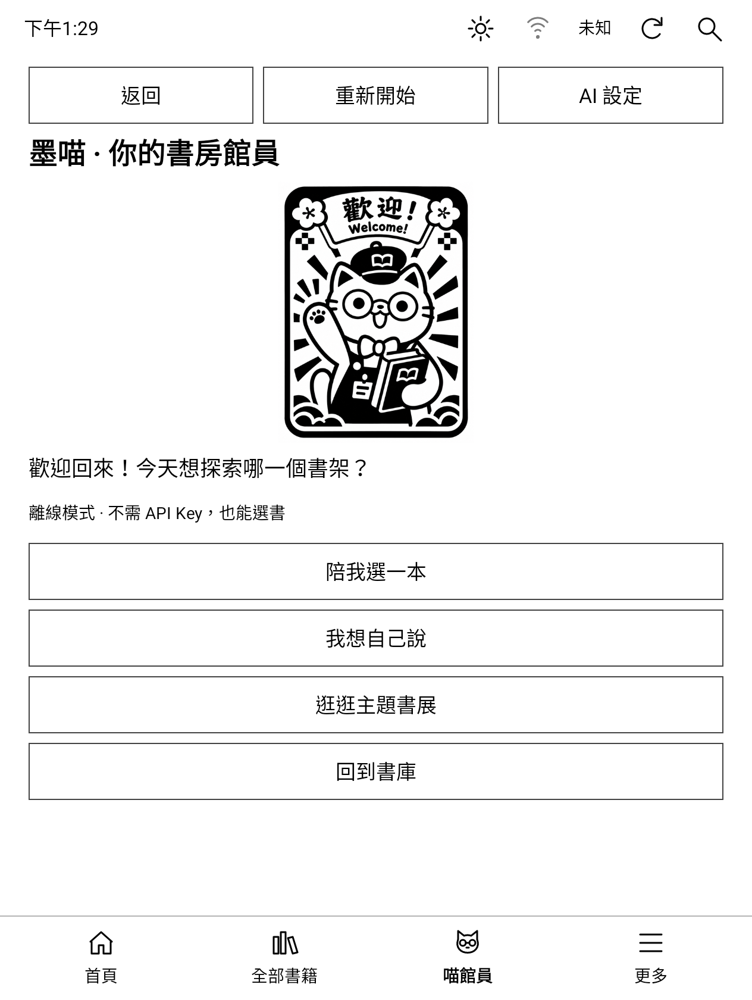
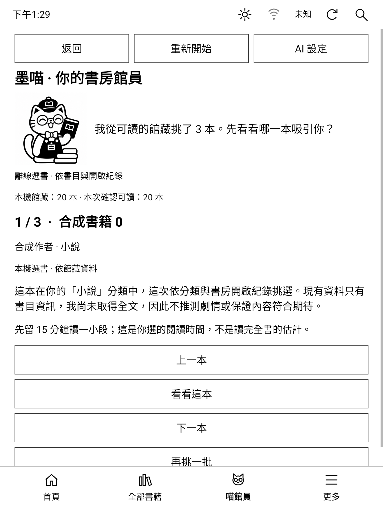
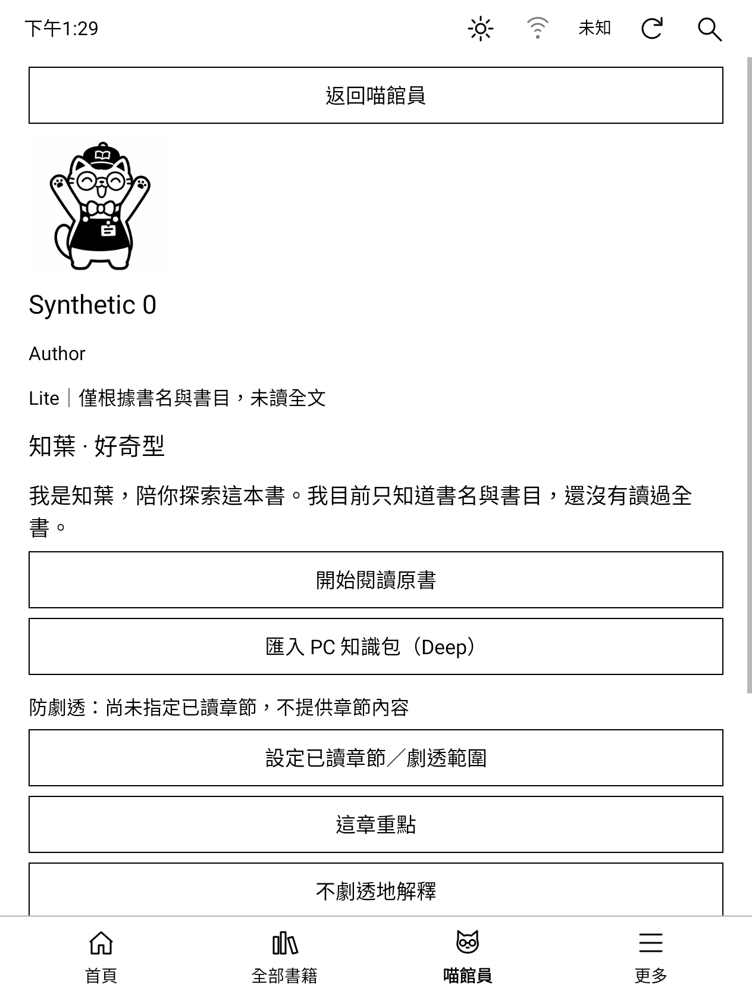
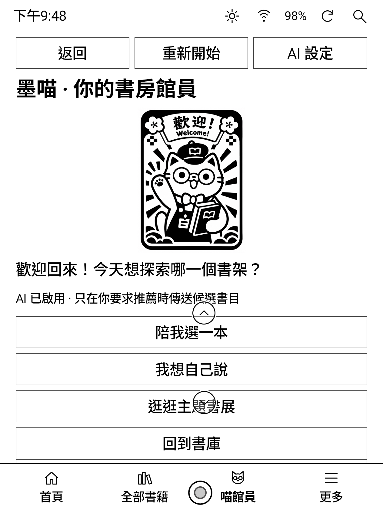
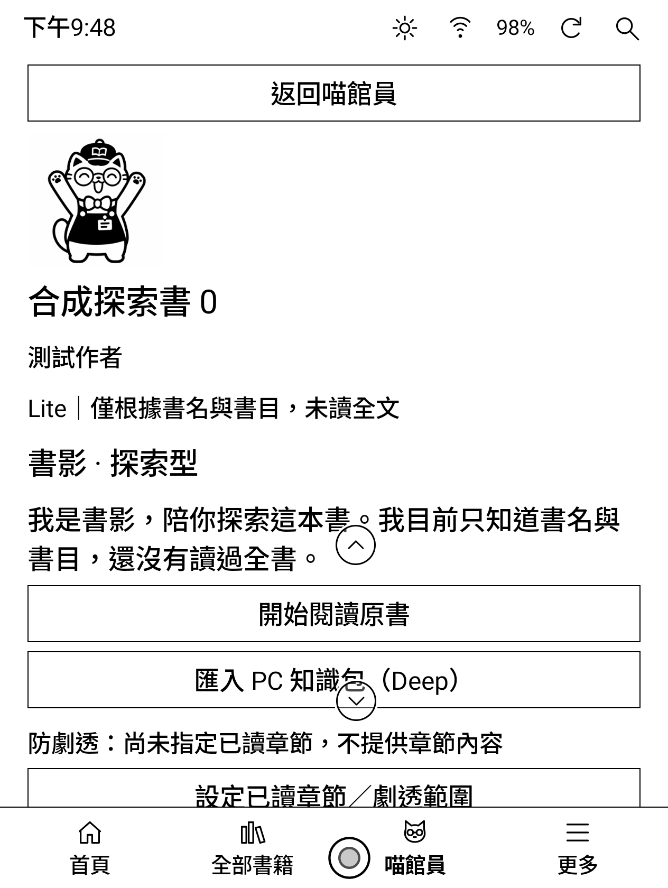
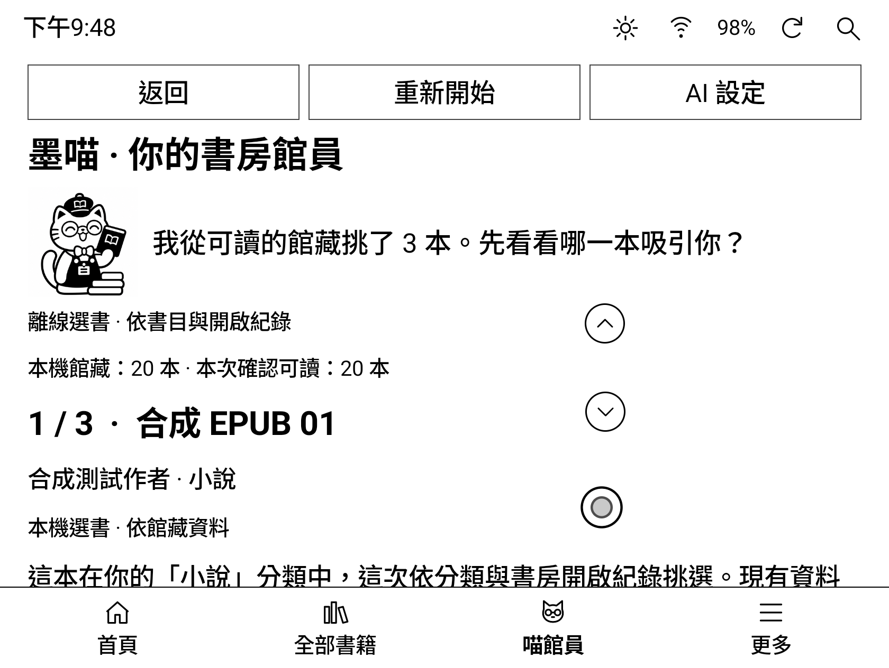

# 喵館員第二版造型

使用者提供 `cat_sprite_sheet-02.png`，並同意「首頁完整歡迎卡片、對話區簡化角色」方案。本次更新圖片與首頁圖片比例；選書、書靈、API、資料庫及 HOME 行為沒有改動。

## 素材與配置

來源保存在 [cat-v2-source.png](cat-v2-source.png)，SHA-256：`C08C3A6D317A92AF8941FC9E3F819FB7035DB29C5DB2390F511C2AB897A53A7A`。

使用內建 `image_gen` 依原圖分別整理七張素材，六種簡化表情保留圓眼鏡、黑色書本帽徽、制服與識別證；歡迎卡片保留標語、邊框及裝飾。這是 AI 輔助整理，並非逐像素裁切；[提示詞紀錄](cat-v2-prompts.json) 保留各素材要求。生成後只做等比例縮放、白底置中，沒有在 App 執行生成或載入遠端圖片。

| 素材 | 尺寸 | 使用位置 |
|---|---|---|
| `cat_welcome_card.png` | 480 × 640 | 直向喵館員歡迎頁，165 × 220 dp |
| `cat_welcome.png` | 320 × 320 | 橫向歡迎頁 |
| `cat_thinking.png` | 320 × 320 | 選擇條件、處理中及書靈載入 |
| `cat_recommend.png` | 320 × 320 | 推薦書籍 |
| `cat_curious.png` | 320 × 320 | 心情／主題選擇與未建立的書靈 |
| `cat_happy.png` | 320 × 320 | 選書確認、已建立的書靈 |
| `cat_reading.png` | 320 × 320 | 書籍介紹 |

正式資源位於 `app/src/main/res/drawable-nodpi/`。直向首頁維持原先 220 dp 高度，改用 3:4 比例；小圖仍為直向 120 dp／橫向 96 dp。使用 FIT_CENTER、靜態圖片，不加入動畫或定時重繪。

## 驗證命令

```powershell
. .\scripts\use_local_tools.ps1
.\gradlew.bat assembleDebug assembleDebugAndroidTest testDebugUnitTest --tests 'org.kobostyle.launcher.librarian.LibrarianUiTest' --tests 'org.kobostyle.launcher.spirits.SpiritUiTest' lintDebug --console plain
& .tools/android-sdk/build-tools/35.0.0/apksigner.bat verify app/build/outputs/apk/debug/app-debug.apk
powershell -NoProfile -ExecutionPolicy Bypass -File scripts/diagnose_device.ps1
git diff --check
```

已執行既有兩組介面測試，共 11 項通過，0 failures／errors／skipped；涵蓋離線選書、六種圖片解碼、介面重建、橫向大字可捲動與書靈流程。所有書籍為合成資料，App API 使用 mock，沒有真實選書／書靈 API 請求。

建置 `BUILD SUCCESSFUL`（1 分 56 秒），正式與 instrumentation debug APK 均產生；正式 APK 簽章驗證 exit 0。Lint 0 errors／61 warnings，與前次數量一致；`git diff --check` 通過。此輪只重跑相關 11 項介面測試，沒有重跑全部 106 項歷史測試。

接機前的唯讀診斷在裝置數量／授權前置檢查停止：當時未找到唯一已授權裝置，因此未執行裝置 shell 診斷、安裝或 instrumentation。後續使用者接機後的結果如下。

## 電腦端預覽

以下為本次 Robolectric 渲染，**不是 Leaf2 實機截圖**。已檢視歡迎卡片完整邊框、推薦及書靈角色、橫向大字換行與操作可達性。





## 同日 Leaf2 接機驗收

使用者回覆「leaf2已接上，請繼續開發測試」後，前後執行唯讀診斷均確認一台已授權 Leaf2、BOOX 4.0.2／Android 11／API 30、build 10545、1264 × 1680／300 dpi，0 個診斷命令失敗。已用 `adb install -r` 覆蓋安裝上述正式與測試 APK，兩次均為 `Success`；沒有清除資料、更改系統設定或重新選擇 HOME。

```powershell
powershell -NoProfile -ExecutionPolicy Bypass -File scripts/diagnose_device.ps1
adb shell am force-stop org.kobostyle.launcher
# 本機忽略目錄中的稽核工具：僅讀本 App 的資料庫，保存本機副本並比較列數／hash。
python .tools/cat-refresh-20261126/device/check.py audit before
adb install -r app/build/outputs/apk/debug/app-debug.apk
adb install -r app/build/outputs/apk/androidTest/debug/app-debug-androidTest.apk
adb shell am instrument -w -r -e class 'org.kobostyle.launcher.LibrarianDeviceAcceptanceTest,org.kobostyle.launcher.SpiritDeviceAcceptanceTest#isolatedSpiritUiCreationRotationAndLocalEvidence' org.kobostyle.launcher.test/androidx.test.runner.AndroidJUnitRunner
adb shell am start -W -n org.kobostyle.launcher/.ui.MainActivity
# 開啟正式喵館員頁，確認歡迎卡片。
adb shell input tap 785 1605
adb shell am force-stop org.kobostyle.launcher
python .tools/cat-refresh-20261126/device/check.py audit after
python .tools/cat-refresh-20261126/device/check.py compare
powershell -NoProfile -ExecutionPolicy Bypass -File scripts/diagnose_device.ps1
adb shell am start -W -n org.kobostyle.launcher/.ui.MainActivity
```

稽核工具與原始副本留在忽略目錄 `.tools/cat-refresh-20261126/device/`，不隨專案發布；`before`／`after` 目錄只供本次使用，不可直接覆寫重跑。沒有讀取 NeoReader 私有資料或 API Key。

- Instrumentation：`OK (2 tests)`，21.712 秒。既有測試涵蓋 20 本已授權合成書的三本離線推薦、應用入口、畫面重建、直橫向字級 1.3、48 dp 觸控目標、捲動及標準 PageDown 注入；另驗證合成書 Lite 建立、缺乏證據的說明及重建後操作。未指定 `openReaders=true`，沒有啟動 NeoReader 或真實 AI。
- 升級前後主書庫 schema 3、13,618 本書、4 個來源逐列摘要一致；書靈 DB schema 1、1 個書靈、1 個知識包、4 個片段、1 個閱讀邊界及 3 筆既有 AI 用量逐列摘要一致。三份非金鑰偏好檔案與 HOME 解析結果亦一致。兩個 DB `quick_check` 均為 `ok`。
- 正式 MainActivity 可啟動並顯示新歡迎卡片；已回到正式喵館員頁供使用者觀察。測試 transport 記錄 `networkCalls=0`／`liveApiCalls=0`，正式 AI 用量及診斷偏好亦無變化。
- 已檢視下方實機截圖：卡片邊框完整，簡化角色未裁切，橫向大字能捲動至操作區。BOOX 原生懸浮按鈕仍可能遮住部分畫面，未更改其設定。螢幕擷取最初遇到 OEM 在 PNG 前加診斷文字，本機擷取工具改為從 PNG 簽名起保存原始影像後成功；不是修改螢幕圖片。
- **人工觀察待回覆**：已請使用者確認新版圖片大小、清晰度與實體電子紙殘影／刷新。本次程式注入 PageDown 不能當作重新驗證實體翻頁鍵；沒有新增付費 AI 或測其他韌體。

正式 App 歡迎頁：



隔離測試的合成推薦／書靈與橫向畫面：




