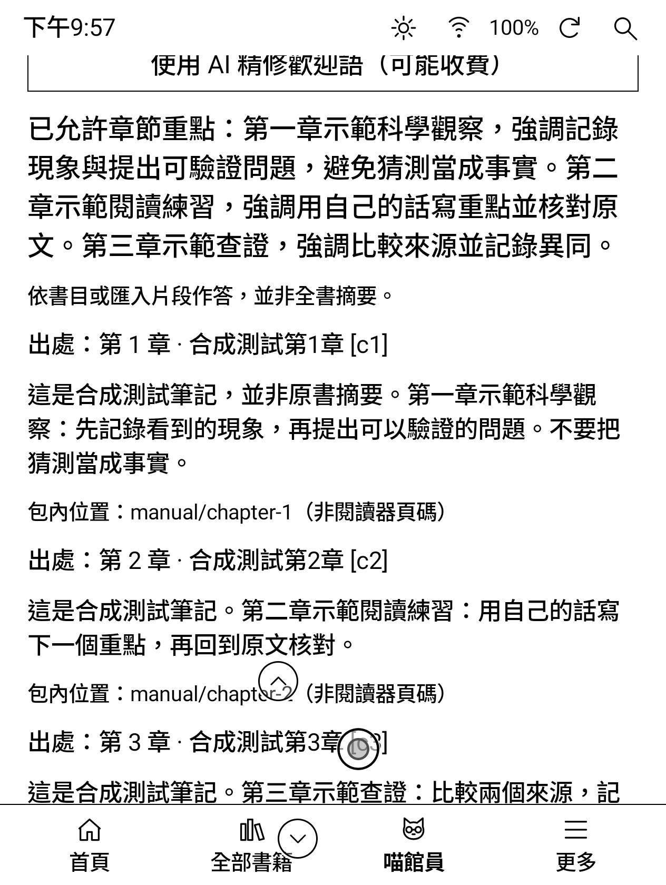
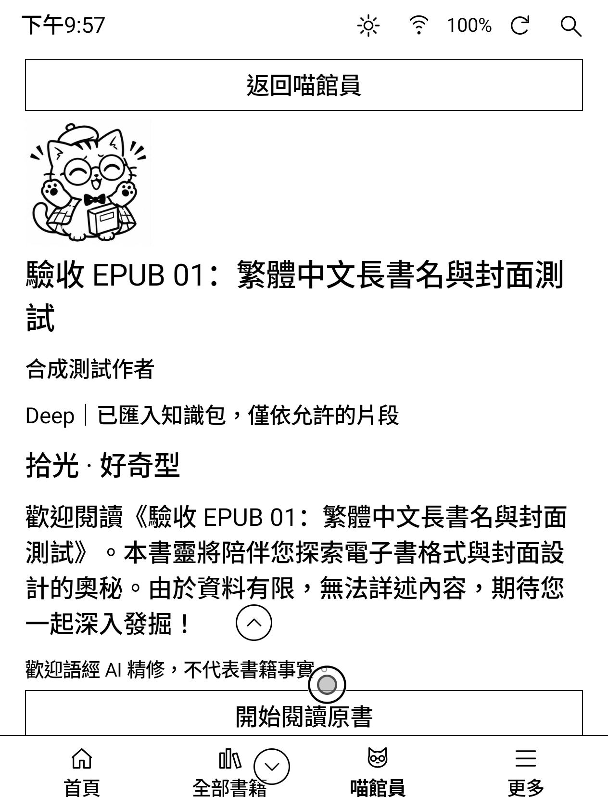

# V4 書靈：Leaf2 實機驗收

日期：2026-11-25，Asia/Taipei。使用者已接上並授權 Leaf2；本紀錄接續 [P1–P5 主機開發](IMPLEMENTATION_2026-11-25.md)。測試只更新 KoboStyle 及其測試 APK，沒有更改 HOME、系統設定或 BOOX 套件。

驗收狀態：**本輪 V4 P1–P6 已完成**。使用者在最後人工確認要求後回覆「確認ok, 請繼續」，確認電子紙文字與刷新可接受、上下實體鍵能在書靈頁捲動。此結論限於下列已記錄的測試範圍；長期待機與其他韌體等限制仍保留。

## 裝置與資料保留

`scripts/diagnose_device.ps1` 確認一台 authorized Leaf2，Android 11／API 30、1264×1680／300 dpi、韌體 4.0.2，唯讀命令失敗數 0。當前 HOME 為 `org.kobostyle.launcher/.ui.HomeEntry`，原廠 HOME `com.onyx/.StartupActivity` 仍可解析。EPUB／PDF capability discovery 回傳 `com.onyx.kreader/.ui.ReaderHomeActivity`；這是此次觀察，程式沒有硬編碼該元件。

實際書庫為 **13,618 本、4 個來源、17 本具有本 App 的開啟時間**。這次數量來自裝置，不是主機合成資料。升級前主書庫 schema 2，升級後 schema 3；原 books／sources 的全部欄位按主鍵排序後逐列比對相同，SQLite quick_check 通過。Key 保留在裝置，未擷取 Key／Keystore 檔案。

| 升級前後比較 | SHA-256（排序後列資料的 JSON） |
|---|---|
| books，13,618 列 | `b8aabf5945e0b216e424f4f394512641ef54fa13011709066b4242b558695d7d` |
| sources，4 列 | `a80df2da01644e365c2d16c5a66bc2ae393997444c0bd8ca503f5f0adebf9954` |

原始資料庫、文件 URI、裝置識別碼與私人書庫截圖只留在忽略的 `.tools/v4-device-20261125/`，不納入公開儲存庫。曾有一次在索引寫入中複製 DB／WAL 的副本不一致；程序停止後重新複製通過，不能把該不一致副本當成裝置資料庫毀損。

## 實測後修正與效能

初版逐本投影及確認變更，各自提交 SQLite transaction，在 Leaf2 首次建立索引太慢。改為每批最多 50 本寫入衍生索引，再以另一個 transaction 確認該批原始 revision；中途終止可重做，並保留同時發生的新 revision。增加超過 500 ms 的準備索引提示。資料表結構沒有再次改版。

- 修正前中斷時已投影 4,364 本，尚餘 9,254；修正後剩餘部分完成耗時 **87,295 ms**。這不是完整 13,618 本的首次建索引時間，也不是冷啟動時間。首次建立仍可能需數分鐘。
- 完成後衍生 catalog／FTS 各 13,618 筆，變更佇列為 0；中文搜尋、增量標題更新及舊詞移除通過。
- 真實書庫連續查詢 50 頁，每頁最多 50 本，**P95 267 ms**。抽樣 20 本推薦候選的 SAF descriptor 均可讀，原有四項持續讀取授權不變；沒有逐本驗證全部私人藏書。
- 完成索引後進行 10 次程序冷啟動，Android `am start -W` 首畫面 TotalTime：1927、1836、1885、1901、1768、1810、1749、1817、2010、1764 ms，nearest-rank **P95 2010 ms**。每次只 force-stop 本 App，不重開機，OS 檔案快取保留；這不是「全部封面完成」或首次投影時間。
- 一次穩定啟動取樣 TOTAL PSS 49,484 KB、RSS 92,408 KB、swap 1,669 KB。未執行長期待機／全庫每本開書壓測，不能推論所有操作的記憶體上限。

## 自動測試

主機 `testDebugUnitTest lintDebug` 通過：106 tests、0 failures／errors／skipped，Lint 0 errors／61 warnings。最後 `assembleDebug assembleDebugAndroidTest lintDebug` 成功。既有 Python adapter 2/2 的結果沿用同日主機開發紀錄；本輪未修改 adapter。主 APK 的 v2 debug 簽章驗證通過，SHA-256：`903590207FD85F8A9A81410D734E8AE45366784FECD5A67663C87152186C0602`。

以下 **8 個不同實機測試分別通過**，不是第一次整批執行即全數成功。測試中的 AI 均為 fake transport，沒有使用真實 Key 或付費 API。

| 測試 | 實際涵蓋 |
|---|---|
| `SpiritDeviceAcceptanceTest.actualCatalogProjectionFiftyPagesAndReadGrants` | 真實 13,618 筆投影、50 頁／中文查詢、20 本可讀候選、四項授權與原 AI diagnostics 不變 |
| `nativeLitePackSpoilersAndPersistentCostLedger` | 10 本 Lite 各重進 10 次、原生 Room 關閉重開、知識包交易回復、已讀第 3 章隔離、連按單一請求、取消後 UNKNOWN_BILLING 保留、刪書靈不刪原書 |
| `authorizedSyntheticScanCancelsAndResumesWithoutDeletingBooks` | 已授權合成資料夾實際 23 個 EPUB／PDF，以獨立書庫取消及恢復掃描；不更動正式索引 |
| `isolatedSpiritUiCreationRotationAndLocalEvidence` | 書靈小屋／Lite／無片段說明、Activity 重建、字級 1.3、48 dp 按鈕、標準 PageDown；獨立 runtime 不污染正式書庫 |
| `LibrarianKeyStoreTest` | 裝置 Keystore 使用測試 alias 加密、重存、拒絕竄改及刪除；不讀使用者 Key |
| `LibrarianDeviceAcceptanceTest` | 原 V3 離線選書 FSM、三本合成書、NeoReader 與 chooser、旋轉／字級；三本均一次 Back 返回 |
| `CategoryUiAcceptanceTest` | 分類、作者搜尋、無結果／未分類、返回、旋轉與全部書籍 |
| `ReaderUiAcceptanceTest` | 首頁四封面、網格／固定導覽、搜尋、閱讀器選單與重建 |

遇到的失敗與處理：掃描測試原先假設資料夾只有 20 本，但實際包含後續新增的合成書共 23 本，改為列舉目前符合格式的文件數；書靈 UI 測試誤選同名但不可點的封面文字，改找可點控制項。NeoReader 返回時無障礙快照較舊，造成錯誤的「仍在閱讀器」判斷；改在主執行緒觀察 Activity 視窗焦點，最後三本都只需一次 Back。沒有修改 NeoReader 或以額外 Back 掩蓋回程問題。分類測試受前一失敗的未清理畫面影響，獨立重跑通過。

NeoReader 測試前已展示程序，只開啟既有授權的合成 EPUB／PDF，經 ACTION_VIEW／read grant，核對翻頁及返回。畫面確認合成 EPUB 頁碼 6→7／10、PDF 1→2／2；本 App 記錄自己的開啟事件，不讀 NeoReader 私有 DB 或推測閱讀進度 API。

## 正式畫面及真實 AI

正式 MainActivity 已找到既有合成 `Acceptance-EPUB-01.epub`，從選單進入書靈並免費建立 Lite，畫面正確揭露「未讀全文」。已準備四章合成筆記 `Download/KoboStyleV4Test-20261125/KnowledgePack-Test.json`；前三章是觀察、閱讀與查證練習，第四章包含未讀邊界測試字串，不是真實書籍內容。

系統 SAF 清單自動點選沒有反應，使用者手動選檔後，正式畫面正確顯示目標書名、包內書名、作者及四個片段。確認匯入成功，設定已讀第 3 章、保持「允許所有章節」關閉；付費功能關閉時顯示本機片段與 c1／c2／c3 出處，沒有 c4 或第四章測試字串。

使用者明確同意 **一次合成筆記問答、一次歡迎語精修**，使用裝置既有 Key、各次本機估計不超過 USD 0.02、不重試。已在正式 UI 設定單次上限 USD 0.02，模型維持 `gpt-4.1-mini`，本機輸入／輸出單價設為每百萬 tokens USD 0.40／1.60；依同日 [OpenAI 官方模型頁](https://developers.openai.com/api/docs/models/gpt-4.1-mini) 核對，未更換模型或擷取 Key。每日 USD 1／每月 USD 5 保留。

兩次均逐一查看 App 費用確認後才送出。**本輪真實 API 共 2 次，沒有重送或額外付費呼叫**：

| 動作 | 本機預估上限 USD | 有效 usage（input／output） | ledger 狀態 | 本機依 usage 核算 USD |
|---|---:|---:|---|---:|
| `ask`：整理已允許章節重點 | 0.001268 | 422／115 | SUCCESS | 0.000353 |
| `refine`：依書目精修歡迎語 | 0.001211 | 392／88 | SUCCESS | 0.000298 |

兩筆 transport 都收到成功 HTTP 及有效 usage，回應通過應用程式的結構與引用檢查；最後一次 HTTP diagnostics 為 200／error none。總計本機核算 **USD 0.000651**，這是依已填單價與供應商回傳 usage 的計算，**不是供應商帳單**。V3 的 `attempts` 計數與舊 token diagnostics 不包含新書靈請求，不能用它判斷 V4 是否呼叫；應查看 V4 `usage` 表／「AI 用量紀錄」。

問答實際整理前三章的觀察、閱讀及查證練習，引用 c1／c2／c3，沒有第四章測試字串；精修歡迎語提醒資料有限，畫面標示「歡迎語經 AI 精修，不代表書籍事實」。不是每個模型未來每次都能正確回答；本次只證實這兩次合成輸入的 API 合約與畫面流程。未擷取網路 payload，未讀章節的送出前隔離另由本機資料層測試確認。

AI 完成後一致性副本 quick_check 通過，books／sources 的逐列 hash 與升級前完全相同。`spirits` 1 筆、`packs` 1 筆、`sections` 4 筆、邊界 chapter=3／spoilers=false、refined=true、usage 恰好 2 筆。

下圖為 Leaf2 實際畫面，僅含合成驗收資料。截圖能核對排版與回應，不代表實體電子紙殘影驗證。




正式 UI 關閉 V4 後，原 V3 館員歡迎頁正常、書靈入口隱藏，原書庫載入後顯示 13,618 本；舊模式讀取整庫期間曾短暫顯示初始 0 本，載入後恢復，沒有刪資料。再開啟 V4，書靈、精修歡迎語、四章知識包、手動邊界及兩筆費用均保留。最後停止本 App、取得一致性快照並重新啟動，兩個 DB quick_check 通過，原 books／sources hash 仍與升級前一致；正式書靈畫面再次確認還原。切換及重新啟動沒有新增 API 請求。

功能開發、可自動驗證與正式 SAF／真實 API 流程已完成。使用者最後回覆「確認ok, 請繼續」，確認本輪書靈畫面的文字大小、殘影／刷新可接受，下方及上方實體鍵可捲動並返回；**P6 人工驗收通過**。這是使用者的實體觀察，與截圖／注入 PageDown 分開記錄，未推論為量化殘影或長期耗電測試。唯讀診斷為 0 個失敗，既有 HOME／閱讀器解析未變。收尾只更新文件，沒有再發出 API 請求、改動裝置或重新選擇 HOME。

## 重現命令

以下只在使用者接機並授權後執行；有多台裝置時先明確選定目標。實機測試會更新本 App 及開啟合成測試書，故應先展示開書程序。測試 APK 不隨正式發行提供。

```powershell
# 本開發電腦的工具環境；一般 clone 依 README 設定 JDK／SDK
. .\scripts\use_local_tools.ps1
powershell -NoProfile -ExecutionPolicy Bypass -File .\scripts\diagnose_device.ps1
.\gradlew.bat assembleDebug assembleDebugAndroidTest testDebugUnitTest lintDebug --console plain
adb install -r app/build/outputs/apk/debug/app-debug.apk
adb install -r app/build/outputs/apk/androidTest/debug/app-debug-androidTest.apk
adb shell am instrument -w -r -e class org.kobostyle.launcher.SpiritDeviceAcceptanceTest org.kobostyle.launcher.test/androidx.test.runner.AndroidJUnitRunner
adb shell am instrument -w -r -e class org.kobostyle.launcher.LibrarianKeyStoreTest,org.kobostyle.launcher.LibrarianDeviceAcceptanceTest,org.kobostyle.launcher.CategoryUiAcceptanceTest,org.kobostyle.launcher.ReaderUiAcceptanceTest -e openReaders true org.kobostyle.launcher.test/androidx.test.runner.AndroidJUnitRunner
# 單項重跑：將 -e class 的值換為 完整類別名稱#方法名稱
adb shell am force-stop org.kobostyle.launcher
adb shell am start -W -n org.kobostyle.launcher/.ui.MainActivity
adb shell dumpsys meminfo org.kobostyle.launcher
& "$env:ANDROID_HOME\build-tools\35.0.0\apksigner.bat" verify --verbose app/build/outputs/apk/debug/app-debug.apk
git diff --check
```

實機 V4 測試需要已索引且可讀的書庫，以及歷史驗收資料夾 `Download/KoboStyleAcceptance-20261115/valid` 的 SAF grant；不會自動取得全磁碟權限。Reader bridge 測試需要該資料夾內既有合成 EPUB／PDF。其他電腦／裝置應先建立並授權相同的測試資料，不能直接套用本機資料庫或 Key。

## 範圍限制

本次只驗證此 Leaf2／韌體／provider。新韌體、其他 provider、長期待機耗電、實體拔插／重開機故障矩陣未在 V4 重做，歷史結果不等於這次重測。沒有閱讀進度同步、全書 AI、背景批次孵化或自動重送。功能回退是關閉 V4，保留 schema 3 資料；不支援直接安裝舊 schema 2 APK。
