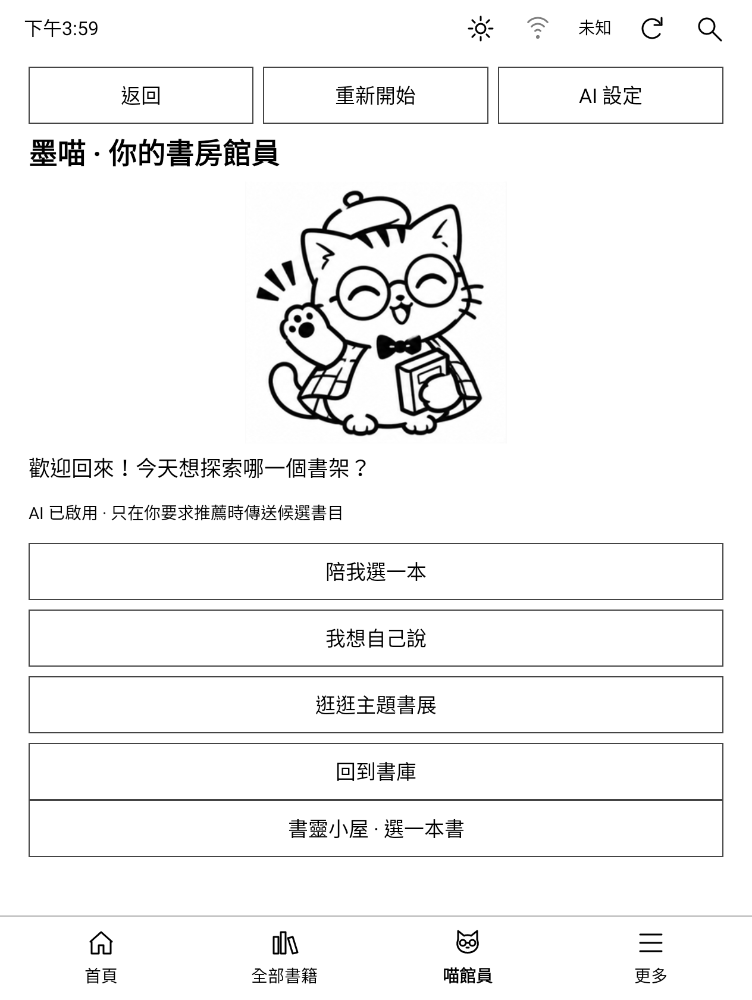
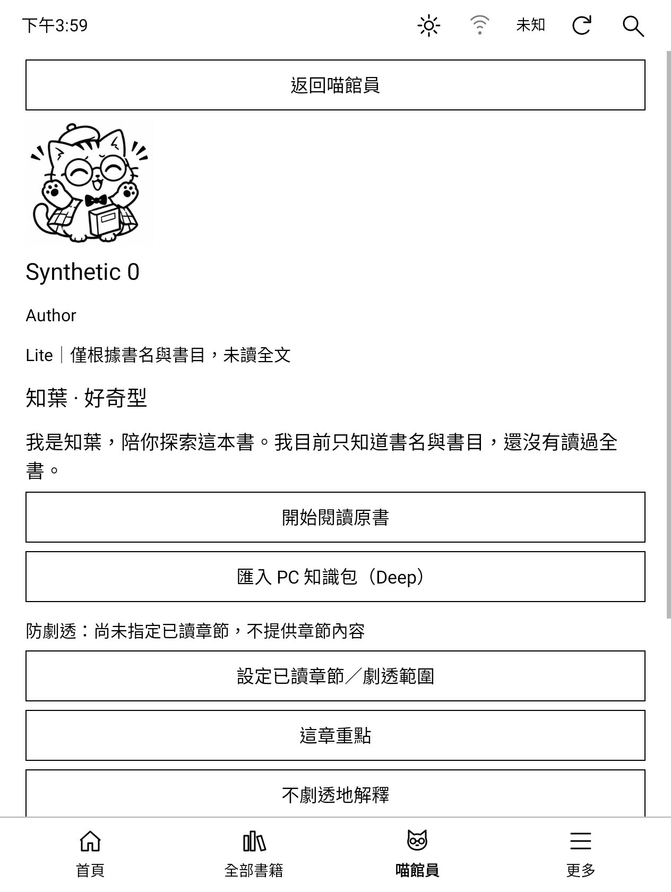

# V4 書靈：P1–P5 主機開發與驗證

同日後續使用者已接上 Leaf2，新版已覆蓋安裝；實機修正與最新結果以 [P6 驗收紀錄](DEVICE_ACCEPTANCE_2026-11-25.md) 為準。下方「未連接／待實機」描述保留為接機前的主機驗證範圍。

日期：2026-11-25。使用者明確授權 P0 稽核後繼續 P1–P5；Leaf2 未連接，本輪沒有執行 ADB、安裝、HOME 操作或真實 API 請求。P6 實機驗收尚未完成。

分支：`feature/meow-v4-book-spirits`。V3 基準 `b6ef3c1`；P0 稽核 commit `9f2d70a`；P1–P5 整合實作與測試 commit `d16331a`（資料結構、gateway 與 UI 跨階段相依，採單一整合提交）。原始規格包 `spec-librarian-v4/` 與 `spec-librarian/` 保留，不修改或整包提交。參見 [稽核](REPO_AUDIT.md)、[實作對照](IMPLEMENTATION_MAP.md)。

## 使用方式

1. 安裝新版後，原有 V3 設定與加密 Key 保留。到「更多 → 書靈與費用設定」，勾選「啟用 V4 書靈與分頁書庫」並儲存。新旗標與書靈付費功能預設都關閉。
2. 到「喵館員 → 書靈小屋 · 選一本書」，選書後按「免費建立 Lite 書靈」。也可由書籍旁的「⋯」或推薦詳情進入。Lite 只根據書目產生固定的人格與歡迎語，沒有讀過全文，也不呼叫 API。
3. 可匯入自己準備的單本知識包：選取 JSON、核對目標書名與包內書名，再確認匯入。之後手動設定已讀章節；不知道進度時，預設不提供任何章節內容。這不是 NeoReader 進度同步。
4. 按「這章重點／不劇透地解釋／提出一個問題／我要自己提問」。資料不足時直接說明；未啟用付費 AI、無 Key、停止 AI 或離線時，只顯示允許的本機片段。片段是匯入資料，不是新生成的回答。
5. 若要使用 AI，在既有「喵館員 AI 設定」啟用 OpenAI 並在裝置保存 Key；在「書靈與費用設定」允許付費問答，確認目前模型的輸入／輸出單價與預算。每次需另行同意費用預覽，才送出一次請求。不要把 Key 放入聊天或命令列。
6. 「更多 → AI 用量紀錄」可查看最近 20 筆與今日／本月累計；「緊急停止所有 AI」立即阻止新請求並取消目前工作。已送出的請求即使取消，也可能已計費。

V4 開啟後，原有線上推薦同樣經過費用確認；V4 關閉時保留 V3 原有 opt-in 推薦行為，仍受共用單一請求鎖與緊急停止控制。原有推薦快取命中不會再次呼叫 API。正式程式已取消自動重試。

## 各階段交付

| 階段 | 實作及主要檔案 | 主機驗證範圍 | 限制／實機待驗 |
|---|---|---|---|
| P1 費用控制 | `spirits/OpenAiGateway`、`SpiritSettings`、`SpiritDialogs`、用量 Room 表；原 `CuratorService`／`LibrarianViewModel` 整合 | 未啟用／未知價格／過額／取消／資料庫失敗拒絕；連按、跨請求單一鎖、停止、未知扣款、日期跨月；四種書庫大小各 10 次啟動／返回／HOME intent／重建零呼叫 | 不是銀行級硬限額；真實 API、平台限額與實機程序終止待驗 |
| P2 大書庫 | 主書庫 2→3 新增變更佇列、掃描佇列；獨立 `SpiritDatabase` v1 使用 bundled SQLite FTS5；`PagedCatalog`、`LibraryRepository`、主畫面分頁 | 真正 Room migration 保留原資料；13,618 本、50 頁、中文搜尋、增量更新、候選排序；取消／provider 失敗／額度中止後手動續掃 | Leaf2 2 GB RAM、冷啟動 P95、初次投影速度、SD provider 真實取消延遲待驗 |
| P3 Lite | `SpiritRepository`、`SpiritViewModel`、`SpiritPanel`；原喵館員與書籍選單入口 | 10 本建立／重進／刪除穩定；原書保留；畫面重建、關閉旗標回到 V3 | 固定模板，不能假裝知道內容；電子紙、字級／橫向與實體鍵待驗 |
| P4 單書問答 | `SpiritAnswers`、單書檢索、手動閱讀邊界、短期對話；經同一 gateway | 無資料／未知進度零呼叫；跨書與未讀章節隔離；不合法 citation／工具輸出拒絕；連按問答、精修各一次、改邊界清除舊語境、本機片段 | 引用白名單不保證模型推論正確；真實 Responses 合約與回答品質待驗 |
| P5 知識包 | `KnowledgeImporter`、SAF OpenDocument、交易式替換；Windows `convert_skill_to_pack.py` | 嚴格 UTF-8／結構／版本／大小／章節 hash／重複 ID；中途出錯與二次讀取變更 rollback；PC 中文與 astral 字元分段、拒絕覆寫 | SAF 選擇器與權限生命週期待實機；未安裝或執行外部 Book-to-Skill，未自動轉換電子書 |

所有主機 AI 測試用 fake transport、假 Key 與合成書目；沒有讀取私人書庫或真實 Key。0／300／13,618／20,000 本 UI 測試使用預先建立的投影，每種 10 次 Activity 建立與重建，不等於實體裝置冷啟動或記憶體壓測。50 頁檢索與索引變更另由資料層測試驗證。

## 重現命令與結果

Windows PowerShell，JDK 17、SDK 36、Gradle 8.13。此開發電腦已備妥 `.tools`；一般 clone 依根目錄 README 設定工具即可，不需該私有目錄。

```powershell
. .\scripts\use_local_tools.ps1
# P1–P5 的完整主機驗證；不會呼叫 adb 或真實 OpenAI
.\gradlew.bat assembleDebug assembleDebugAndroidTest testDebugUnitTest lintDebug --console plain
# P5 Windows adapter
python -m unittest discover -s scripts -p test_convert_skill_to_pack.py -v
git diff --check
# 驗證本機 debug APK 簽章（不安裝）
& "$env:ANDROID_HOME\build-tools\35.0.0\apksigner.bat" verify --verbose app/build/outputs/apk/debug/app-debug.apk
```

各階段可獨立重跑：

```powershell
# P1
.\gradlew.bat testDebugUnitTest --tests '*GatewayTest*' --tests '*SpiritUiTest*' --console plain
# P2
.\gradlew.bat testDebugUnitTest --tests '*SchemaMigrationTest*' --tests '*ScanTraversalTest*' --tests '*SpiritDataTest.catalog13618PagesSearchAndIncrementalUpdates*' --console plain
# P3
.\gradlew.bat testDebugUnitTest --tests '*SpiritDataTest.liteTenBooksStableReentryAndDeletionPreservesOriginal*' --tests '*SpiritUiTest*' --console plain
# P4、P5（含匯入、邊界、引用與問答）
.\gradlew.bat testDebugUnitTest --tests '*SpiritDataTest*' --console plain
```

最終完整命令 exit 0，BUILD SUCCESSFUL（1m 18s）；106 tests、0 failures／errors／skipped。Lint 0 errors／61 warnings，未新增 suppress baseline 隱藏錯誤；仍有原生 View／文字資源等寫法建議待整理。Python 2/2 通過，exit 0；`git diff --check` exit 0。

兩份 APK 建置成功只表示編譯完成，`assembleDebugAndroidTest` 不會執行實機測試。主 APK：`app/build/outputs/apk/debug/app-debug.apk`；SHA256：`FBF385DF15E7BC684047CA1AE142E0F2D8A9497577C9E5A6C452027089E49701`。測試 APK：`app/build/outputs/apk/androidTest/debug/app-debug-androidTest.apk`。主機原始 logs／HTML reports 位於忽略的 `.tools/v4-final-validation.log`、`app/build/reports/`，不包含任何本輪裝置資料。

開發中遇到並已修復：Windows Robolectric 缺少 bundled SQLite JNI（從同版官方 JVM artifact 提取 native library）；bundled driver 不支援舊 `withTransaction` 路徑（改用 writer connection 交易）；MigrationTestHelper 的 schema assets 與 Windows 絕對路徑問題。未略過失敗測試或以 destructive migration 規避。

APK v2 debug 簽章驗證 exit 0。待提交文字經憑證樣式檢查未發現 Key／private key；這不是完整秘密掃描保證。未包含 `.tools`、資料庫、裝置原始輸出或私人書名。

生命週期回歸另外驗證：一般旋轉保留 ViewModel，費用確認以弱參照重新綁定目前 Activity；V4 開關儲存則清除既有 ViewModel 再重建，避免舊的整庫／分頁資料來源模式被保留。測試實際操作設定頁關閉／開啟 V4，確認原書可見且全程零 API。

## 設計差異與限制

- 原書仍在 `library.db`；Room 2→3 只增加追蹤與掃描表，原有 identity／來源／URI／開啟紀錄保留。書靈／知識包／書目搜尋投影／費用在 `spirits.db` v1。SQLite FTS5 由 bundled driver 提供，不假設 BOOX 系統 SQLite 支援。六張貓咪 PNG、原有 FSM、KeyVault、Reader bridge、HOME／復原程式保留。
- V4 書庫每頁最多 50 本，SQL 搜尋及作者／分類分組；喵館員先從索引挑最多 60 本，再核對最多 20 本可讀候選。短於 3 字的中文查詢使用 SQL substring；較長用 trigram FTS。沒有 embeddings、全文索引或全庫 AI 排程。
- 第一次啟用會建立本機書目投影，之後逐批處理變更；畫面不把整本書庫載入 List。掃描 checkpoint 只保存手動工作；取消／重開後需手動繼續，不會背景重掃。來源每次最多 50,000 文件／資料夾、32 層；中斷期間若檔案變更，完整完成後可再掃一次核對。
- 預設每日 20 次、每日 USD 1、每月 USD 5、單次估計 USD 0.05；美元上限可調，次數目前固定。新問答／人格精修最多 300 output tokens；既有三本推薦保留原 1,800 上限以容納原有結構。這項相容差異會在費用預覽明示。
- 輸入用 UTF-8 bytes（含 JSON）保守估算，不是精確 tokenizer。單次 body 上限 40 KB；單書最多 5 個片段且合計最多 1,500 UTF-8 bytes。沒有保證 3,000 精確 input tokens，也不保證每次都有五個片段。usage 有效時依本機單價核算，不另估 cached token 折扣；仍不是供應商帳單。
- timeout／取消／無有效 usage 保留 `UNKNOWN_BILLING`；程序重建不重送。清除資料、修改系統時區／日期仍會影響本機保護；日期倒退會拒絕新請求。平台可用限制須另於 OpenAI Project 設定，App 無法代替平台帳務控制。
- 知識包是外部文字資料。SHA256 用於損壞與兩次讀取一致性檢查，不是作者簽章、可信來源或內容正確性的證明。匯入前須核對書籍；可選的 `metadata-v1:` fingerprint 只綁定 App 書目版本，不是全檔案 hash。檔案修改時間／大小未變時不能偵測所有內容替換。
- 未提供自動電子書轉換、付費批次孵化、雲端同步、閱讀器進度、長期對話記憶、圖像生成或自動價格更新。Deep 使用已匯入片段；本機對話只留最近六則短摘要，換書／改邊界／匯入時清除。
- 停用 V4 保留資料並恢復原 UI；**不可直接覆蓋安裝讀不懂 schema 3 的舊 APK**。復原見 [RECOVERY](../RECOVERY.md)。

## 主機畫面預覽

以下由 Robolectric 繪製實際 View，全部為合成資料；不是 Leaf2 截圖，無法證明 E Ink 顯示品質。




## P6 接機驗收順序（尚未執行）

1. 使用者接機授權後，執行 `scripts/diagnose_device.ps1`，記錄現況。備妥本 App 資料的本機復原副本，公開文件只保留去識別化計數／hash；不擷取 Key。
2. 覆蓋安裝前後核對原書、來源、URI grants、開啟紀錄，驗證 schema migration 與原有預設 HOME／原廠復原入口。不要重新選 HOME。
3. 先啟用 V4、保持新付費功能關閉，量測首次投影與後續冷啟動／50 頁／中文搜尋／掃描取消恢復、RAM 及 P95。加入離線 10 本 Lite 建立、刪除、程序重建；檢查電子紙、翻頁鍵、注音與字級。
4. 以合成 pack 經 SAF 完成選取、對書確認、匯入／重匯／壞資料拒絕；未知閱讀進度不得看到章節片段，改已讀範圍後核對本機引用。
5. NeoReader 回歸先展示 [既有 content URI 測試程序](../P3_PROCEDURE.md)，使用合成 EPUB／PDF；由 capability discovery 啟動，失敗走安全 chooser。
6. 真實 AI 僅在裝置輸入 Key、確認單價與單次預覽後，送一次短問題（最多允許的五個片段）。核對 HTTP／usage／引用與本機 ledger；取消或重複點擊不得自動重送。測試不得擷取 Key 或公開私人片段。
7. 關閉 V4 確認原書庫／喵館員仍可使用、新資料保留。實機性能及以上結果完成前，不宣稱 P6 通過。
